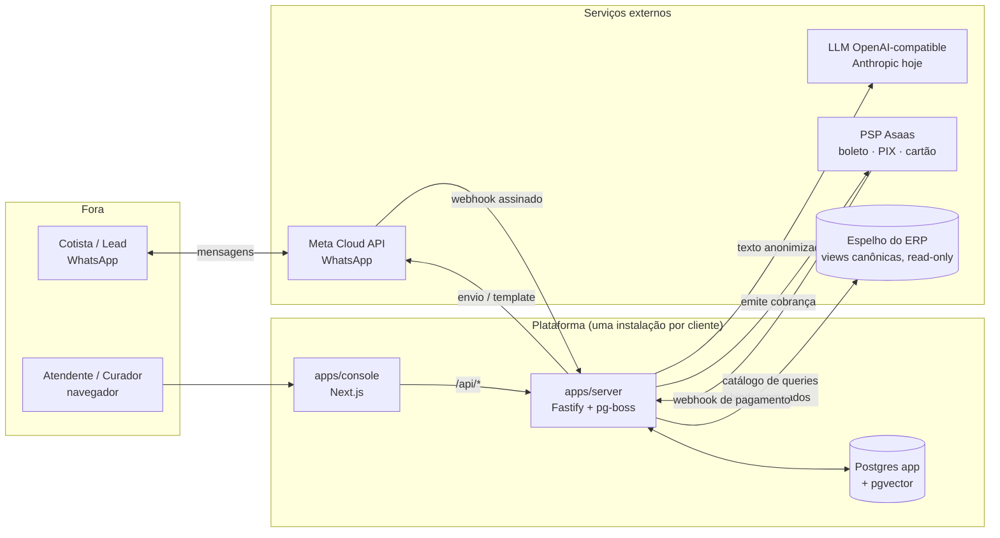

# 01 — Visão geral

## O produto em um parágrafo

Um atendente digital para empresas de **multipropriedade** que usam o ERP TS Explorer. O
cotista fala pelo WhatsApp; o agente responde com dado real do contrato (parcelas, saldo,
cota, cancelamento, chamados), emite cobrança (boleto, PIX ou link de cartão) quando ele quer
pagar, passa a conversa para um atendente humano quando esbarra num limite, e aprende com a
correção do humano — sempre com aprovação antes de mudar de comportamento. A empresa também
dispara campanhas de template para a carteira, mede o resultado contra uma meta de conversão,
e recebe leads sem cadastro num agente de vendas com alçada de desconto. Tudo é auditável por
`traceId`.

## Quem usa e por onde

| Quem | Onde | Faz |
|---|---|---|
| **Cotista** (número com vínculo) | WhatsApp | pergunta, paga, recebe campanha |
| **Lead** (número sem vínculo) | WhatsApp | pergunta preço, recebe oferta, agenda com o comercial |
| **Atendente** | Console › Atendimento, Campanhas, Cobranças, Leads | assume conversas, responde, dispara campanhas, aprova cobranças |
| **Curador** | Console › Aprendizado | aprova ou rejeita as melhorias (skills) que o sistema propõe |
| **Gestor** | Console › Métricas, Configurações | acompanha indicadores e o relatório de campanhas; vê a configuração da instalação |

## Contexto do sistema

## Princípios que não se negociam

Estes princípios moldam o código inteiro. Se uma mudança viola um deles, a mudança está
errada, não o princípio.

1. **Uma base de código, uma instalação por cliente.** Parte dos clientes não permite dado
   saindo da rede deles. A plataforma se instala isolada (config em `configs/<cliente>/`),
   não é multi-tenant. O que precisamos é versionar e instalar bem (decisão D2 do roadmap).
2. **Dado estruturado só entra pelo catálogo de queries.** O agente escolhe uma tool e
   parâmetros; nunca escreve SQL. Cada query é um YAML com binds nomeados, whitelist de
   colunas de saída e masking. Parâmetros `source: session` (o contrato do cotista) nunca
   vêm do modelo. Interpolar valor em SQL é proibido em qualquer camada.
3. **A LLM nunca calcula valor.** Todo número em dinheiro que sai numa resposta precisa ter
   origem numa consulta ao ERP; o guardrail de preço bloqueia o que não rastreia. Na cobrança
   e na venda, o valor vem do sistema, o modelo só redige ou interpreta a escolha.
4. **Políticas por arquitetura, não por prompt.** Guardrails são hooks verificáveis no
   turno (antes da resposta, antes e depois de cada tool). Capacidade ausente é a trava mais
   forte: o agente não tem tool de desconto porque desconto não existe como tool.
5. **Ports com interface, nunca implementação.** `AIProvider`, `DbConnector`,
   `VectorStore`, `SkillRegistry`, `PaymentProvider`, `TemplateApi`/`OutboundGateway`,
   `Detector`. Trocar de LLM, de ERP, de PSP ou rodar on-prem é trocar a implementação atrás
   do port. O dependency-cruiser vigia as fronteiras no CI.
6. **O que sai para a IA é pseudonimizado.** O espelho do ERP não expõe nome nem CPF; o
   texto livre passa por um decorator que troca dados pessoais por tokens antes de qualquer
   chamada e restaura na resposta. Contrato e valores ainda saem (decisão D6).
7. **Humano no circuito.** Escalada abre um ticket; o bot continua atendendo o resto até um
   atendente assumir; cobrança acima do teto e proposta acima da alçada esperam aprovação;
   nenhuma skill entra em produção sem um curador aprovar, e todas têm rollback.
8. **Tudo auditável.** Cada turno grava `trace_turno` com o contexto, as tools, os verdicts,
   a resposta, tokens e latência. Eventos derivados (`evento_llm`, `evento_guardrail`,
   `evento_escalonamento`, `evento_query`) alimentam Métricas e o Aprendizado.
9. **Efeito externo passa pelo outbox.** Toda mensagem de saída vira linha com dedupe antes
   de tocar a Meta; o worker envia com retry e a última tentativa vira dead-letter marcando o
   ticket. Nada é enviado duas vezes por crash.
10. **Uma spec = uma sessão = um PR.** Escopo fechado, critérios de aceite, `pnpm lint &&
    pnpm test && pnpm build` verdes. O que está em "fora de escopo" não entra de brinde.

## O que existe hoje (setembro de 2026)

- 18 specs entregues (000–017), 373 testes automáticos, CI e release verdes no `main`.
- Console redesenhado a partir do design aprovado, com sete áreas.
- O que ainda não existe está mapeado em [08 — O que falta](08-o-que-falta.md), com uma
  pré-spec por item.

## Stack (travada pelo SDK SETA v1.0)

TypeScript estrito · Node 24 · pnpm 10 · Fastify 5 · Zod · Drizzle · Postgres 17 + pgvector ·
pg-boss · Better Auth · pino · UUIDv7 · LangGraph.js · Next.js (App Router) + React 19 ·
Tailwind 4 · shadcn/ui · Vitest · Biome · dependency-cruiser. Dependências fora da lista só
com decisão registrada (`CLAUDE.md`): `yaml`, `uuid`, `pg`, `@huggingface/transformers`.
