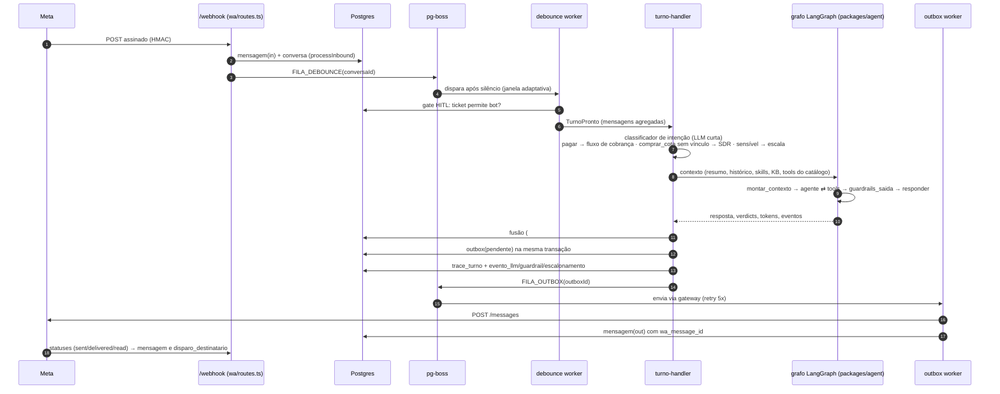
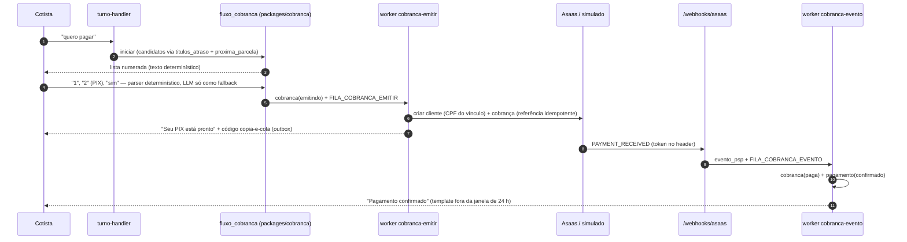
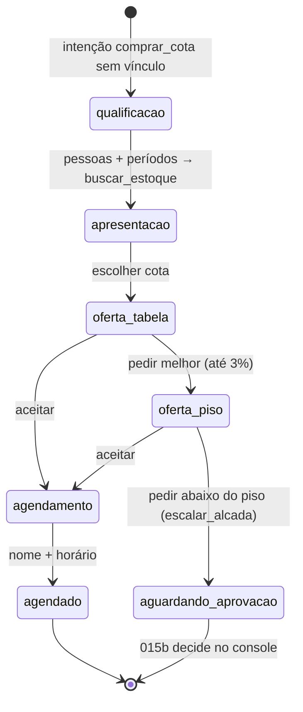

# 02 — Arquitetura

## Monorepo em três camadas

```
packages/*   regras de negócio e ports — sem Fastify, sem Next, sem banco
apps/server  Fastify + pg-boss + Drizzle: rotas, workers, implementações dos ports
apps/console Next.js: telas do atendente, do curador e do gestor; fala só com /api/*
```

Regras vigiadas pelo `dependency-cruiser` (`.dependency-cruiser.cjs`, provadas em
`tools/boundaries.spec.ts`; o CI falha se uma for violada):

| Regra | Por quê |
|---|---|
| `packages/*` não importam de `apps/*` | package é reutilizável; app é montagem |
| `agent` não importa `erp-connector` | o agente só vê dado pelo catálogo de queries (tools), nunca o banco |
| `cobranca` e `sdr` não importam `erp-connector` | idem: os fluxos recebem candidatos/estoque pelo executor, não consultam |
| `anonimizacao` só conhece `ai-provider` | é um decorator do port; não sabe o que é catálogo, agente ou guardrail |
| só `anonimizacao` usa `@huggingface/transformers` | o modelo NER fica confinado num package |

## Ports e implementações

| Port (package) | Interface | Implementações | Onde se escolhe |
|---|---|---|---|
| `AIProvider` (`ai-provider`) | `chat(req)`, `embed(texts)` | OpenAI-compatible (`openai-compatible.ts`), `FakeAIProvider` (`testing.ts`), decorator de anonimização (`anonimizacao/provider.ts`) | `apps/server/src/index.ts`: `LLM_BASE_URL` presente ⇒ real; senão o agente responde o fallback honesto |
| `DbConnector` (`erp-connector`) | `query(sql, binds, opts)` read-only com binds nomeados | `createPgConnector` | `ERP_DATABASE_URL` (usuário `erp_ro`) |
| `VectorStore` (`rag`) | `upsert`, `search` (denso + lexical, RRF), namespaces `kb` e `skills` | pgvector (`apps/server/src/rag/pgvector-store.ts`) | sempre |
| `SkillRegistry` (`skills`) | skills ativas, versões, propostas, rollback | Drizzle (`apps/server/src/skills/registry.ts`) | sempre |
| `PaymentProvider` (`payment-provider`) | `criarCliente`, `criarCobranca`, `consultar`, eventos | Asaas (`asaas.ts`), simulado (`simulado.ts`) | `ASAAS_API_KEY` presente ⇒ Asaas; a base URL decide sandbox/produção |
| `OutboundGateway` / `TemplateApi` (`wa-meta`) | `send`, `sendTemplate`; `criar`, `listar` templates | Meta Cloud API (`gateway.ts`, `template.ts`), log gateway (dev) | `WA_ACCESS_TOKEN` (+ `WA_WABA_ID` para templates) |
| `Detector` (`anonimizacao`) | `detectar(texto) → Deteccao[]` | regex com validação, dicionário de contexto, NER local | `LLM_ANONIMIZAR`, `ANONIMIZACAO_NER` |

Fakes e simulados são de primeira classe: os testes de integração rodam o sistema inteiro
com `FakeAIProvider`, gateway de log, PSP simulado e `TemplateApi` fake.

## O turno: de uma mensagem do WhatsApp à resposta



Pontos que valem memorizar:

- **Debounce** (`wa/debounce.ts`): a janela base é `WA_DEBOUNCE_MS` (10 s); termina com
  `?!.` ⇒ 0,6×; frase curta ou conectivo ⇒ 1,5×. Mensagens que chegam durante o turno são
  fundidas no próximo (`turno-handler.ts`, `enfileirarComFusao`), com teto de descartes
  consecutivos para nunca deixar o cliente sem resposta.
- **Raias** (`turno-handler.ts`, `processarComAgente`): número **com vínculo** ⇒ agente do
  cotista (persona, tools de financeiro/contrato/atendimento, fluxo de cobrança); número
  **sem vínculo** e `modulos.sdr` ⇒ agente SDR (persona comercial, tools `comercial.*`). As
  raias são disjuntas por construção.
- **Grafo** (`packages/agent/src/graph.ts`): `montar_contexto → agente ⇄ tools →
  guardrails_saida → responder`, com `fallback` honesto em timeout, orçamento de tools ou
  bloqueio. `TEXTO_FALLBACK` e `TEXTO_TRANSICAO` são as duas frases fixas.
- **Guardrails** (`packages/guardrails`): `runToolHooks` antes e depois de cada tool,
  `runBeforeReply` no rascunho. Verdicts `allow | rewrite | block | escalate`; todo verdict
  diferente de `allow` vai para o trace e vira `sinal_aprendizado`. Hoje: classificador de
  intenção (escala `negociacao_preco`, `tema_sensivel`, `pedido_explicito`,
  `interesse_compra`…) e guardrail de preço (todo valor no rascunho precisa rastrear a um
  resultado de tool; na raia SDR isso é o que implementa a alçada de desconto).
- **HITL** (`wa/tickets.ts`, `packages/crm`): escalada leva o ticket a
  `aguardando_humano`; o bot continua respondendo outros assuntos; só `humano_ativo`
  silencia o bot; `resolvido` reabre na próxima mensagem. A máquina de estados é uma função
  pura em `packages/crm`.
- **Outbox** (`wa/outbox.ts`): dedupe por `turnoId+seq` ou por chave (`cobranca:{id}:{seq}`);
  retry exponencial; última tentativa vira dead-letter e marca o ticket; um sweeper
  recoloca na fila linhas órfãs de um crash entre o insert e o `boss.send`.

## Cobrança: de "quero pagar" ao pagamento conciliado



- Valor acima de `PAGAMENTO_TETO_SEM_HITL_CENTAVOS` ⇒ `aguardando_aprovacao`; o atendente
  aprova ou recusa em Console › Cobranças.
- O ERP é read-only: a **conciliação** (`pagamentos/conciliacao.ts`) envolve o executor do
  catálogo para que `financeiro.*` reflita as baixas registradas em `pagamento`. Em produção
  o ERP fará a baixa e essa camada some, sem mudar quem consome o port.
- Texto do fluxo é determinístico (`packages/cobranca/render.ts`): nenhum valor passa pela
  LLM, logo nada para o guardrail corrigir.

## Venda (SDR): número sem vínculo



A máquina (`packages/sdr/maquina.ts`) é pura: recebe estado e ação, devolve novo estado,
mensagens e o efeito que o server executa (`apps/server/src/sdr/fluxo.ts`). Ofertas são
pontos discretos (tabela ou piso = tabela − `SDR_DESCONTO_MAX_BPS`); a proposta é gravada
**antes** de ser enviada; o SDR fala em valor, nunca em percentual.

## Filas e workers (pg-boss, schema `pgboss` no banco `app`)

| Fila (`boss.ts`) | Worker | Retry | O que faz |
|---|---|---|---|
| `turno-debounce` | `registerDebounceWorker` (`wa/debounce.ts`) | — | fecha o turno após silêncio e chama o handler |
| `outbox-send` | `registerOutboxWorker` (`wa/outbox.ts`) | 5, backoff | envia pelo gateway; última tentativa ⇒ dead-letter + ticket marcado |
| `outbox-sweep` | `registerOutboxSweeper` | — | recoloca linhas `pendente` órfãs (> 10 min) |
| `disparo-send` | `registerDisparoWorker` (`wa/disparo.ts`) | — | envia template a cada destinatário; falha de um não trava os outros |
| `cobranca-emitir` | `registerCobrancaEmitirWorker` (`pagamentos/emitir.ts`) | 5, backoff | cria cliente e cobrança no PSP; erro de negócio não re-tenta |
| `cobranca-evento` | `registerCobrancaEventoWorker` (`pagamentos/eventos.ts`) | 3, backoff | processa eventos do webhook (idempotente por evento) |

Além das filas há um job diário (`skills/sinais-job.ts`) que coleta sinais de aprendizado.

## Aprendizado (skills)

Sinais (`sinal_aprendizado`: correções do atendente, verdicts, escaladas, feedback 👍/👎 do
console) → `gerarPropostas` (`skills/distiller.ts`, LLM com a resposta tokenizada) →
`proposta` no Console › Aprendizado › Curadoria → aprovação cria `skill_versao` ativa →
`SkillRegistry` indexa no `VectorStore` (ns `skills`) → o retrieval do turno traz as skills
relevantes para o contexto. Desativar e rollback são um clique; `caso_eval` guarda a evidência.

## Console

Next.js App Router; tudo `'use client'`; a API é proxy same-origin (`/api/* →
SERVER_INTERNAL_URL`) para cookies do Better Auth e SSE funcionarem sem CORS. `layout.tsx`
guarda a rota (sem sessão ⇒ `/login`), carrega a instalação e os badges, e mantém o SSE de
tickets. Design system em `app/globals.css` (tokens do design "Console SETA") e
`components/ui/*`. O que não tem backend aparece como nota explícita, nunca como botão morto.

## Decisões registradas

- ADR 0001 — Asaas como PSP (sem SDK; sandbox por base URL).
- `CLAUDE.md` › "Decisões registradas": TypeScript `~5.9`, dependências aprovadas fora da
  lista (`yaml`, `uuid`, `pg`, `@huggingface/transformers`).
- Roadmap D1–D9: as que ainda faltam e o que cada uma destrava.
