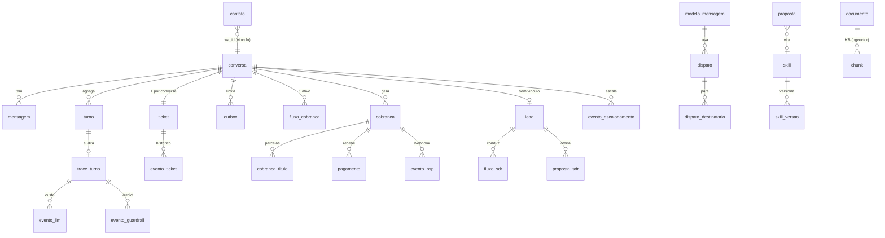

# 05 — Dados e integrações

## Dois bancos, três papéis

| Banco | Dono | O que guarda | Quem escreve |
|---|---|---|---|
| `app` (Postgres 17 + pgvector) | `app_owner` | tudo da plataforma: conversas, tickets, cobranças, leads, skills, KB, auth, traces; schema `pgboss` das filas | o server (Drizzle) |
| espelho do ERP (`erp_mock` em dev; `bali_tse` no piloto) | `erp_ro` | a estrutura do TS Explorer, exposta **só** por 7 views canônicas | ninguém — read-only por `GRANT` |

O ERP simulado tem **três** papéis, e a distância entre eles é a fronteira (035):

| Papel | Enxerga | Quem usa |
|---|---|---|
| `postgres` | tudo | `pnpm db:seed:erp` |
| `erp_ro` | só as 7 views canônicas | o produto (`ERP_DATABASE_URL`) |
| `tse_sim` | `SELECT/INSERT/UPDATE` nas tabelas físicas e no schema `tse_sim`; **zero** nas views | o simulador da API (`TSE_SIM_DATABASE_URL`) |

O simulador **escreve** — é o que destrava baixa de pagamento, reserva e venda — e mesmo assim
não enxerga as views: quem lê o ERP pelo produto é o `erp_ro`, e as duas superfícies não se
misturam. `04-sim-role.sql` cria o papel (senha por bind, nunca literal no `.sql`),
`05-sim-schema.sql` põe no schema `tse_sim` o que a API tem e o mock não tinha
(`utilizacaocontrato`, `hospede`, `casal`, `transacaoeletronica`…) — **fora do `public`**, para
não poluir a superfície que a 018 vai replicar do espelho real — e `06-sim-sequences.sql`
transforma as PKs em `IDENTITY`, sem o que nenhum `INSERT` da API funcionaria.

Em dev os dois vivem no mesmo Postgres do `infra/compose.dev.yml`; os testes usam
`app_test` para não colidir com o `pnpm dev`.

## Banco `app` (36 tabelas, `apps/server/src/db/schema.ts`)



| Domínio | Tabelas | Notas |
|---|---|---|
| Conversa | `conversa`, `mensagem`, `turno`, `outbox`, `conversa_leitura` | `mensagem.autor` ∈ contato, bot, atendente, campanha; `outbox` tem dedupe por turno/seq ou chave |
| Vínculo | `contato` | `wa_id → cliente_erp_id`, apelido, `documento` (CPF só para o PSP); vem de `contatos.yaml` no seed |
| Campanhas (013/017) | `modelo_mensagem`, `disparo`, `disparo_destinatario` | status do destinatário segue o webhook; `disparo.nome` e `meta_conversao_bps` (017) |
| Cobrança (014) | `fluxo_cobranca`, `cobranca`, `cobranca_titulo`, `pagamento`, `evento_psp`, `psp_cliente` | 1 fluxo ativo por conversa; `referencia_externa` idempotente no PSP; `pagamento.recebido_em` tem granularidade de dia |
| SDR (015) | `lead`, `fluxo_sdr`, `proposta_sdr` | proposta é gravada antes de ser enviada; `aguardando_aprovacao` espera a 015b |
| HITL (007) | `ticket`, `evento_ticket` | máquina de estados em `packages/crm` |
| Aprendizado (009) | `sinal_aprendizado`, `skill`, `skill_versao`, `proposta`, `caso_eval` | skill ativa = 1 item no `VectorStore` (ns `skills`) |
| KB (008) | `documento`, `chunk` | `chunk.embedding` é `vector` sem typmod; `EMBEDDING_DIM` define cast e índice HNSW |
| Auth | `user`, `session`, `account`, `verification` | Better Auth; `user.role` ∈ atendente, curador |
| Observabilidade (010) | `trace_turno`, `evento_query`, `evento_llm`, `evento_guardrail`, `evento_escalonamento` | tudo com `trace_id` UUIDv7; buckets de métricas no fuso do cliente (`tz.ts`) |

**Migrações** (`apps/server/drizzle/0000` a `0016`): editar `schema.ts` e rodar
`pnpm --filter @seta/server exec drizzle-kit generate --name <slug>`; o arquivo SQL e o
snapshot entram no PR. `pnpm dev` e `deploy.sh` aplicam (`migrate.ts`). Nunca editar uma
migração já aplicada.

## Espelho do ERP (views canônicas)

`infra/erp-mock/02-views.sql` é o contrato. O produto real conecta ao espelho do cliente com
as **mesmas views** (spec 018 valida isso contra o `bali_tse`).

| View | O que dá | PII |
|---|---|---|
| `v_cotista` | contrato, número, `titular` sintético, status, cliente desde | **nunca** nome ou CPF |
| `v_contrato_cota` | cota, bloco, andar, UH, capacidade, tier, períodos, pontos, status | — |
| `v_titulo` | parcelas (origem entrada/saldo, número, valor, vencimento, pagamento, status, linha digitável, PIX) | — |
| `v_inadimplencia` | agregado por contrato: vencidas, saldo vencido, mais antiga, maior atraso | — |
| `v_cancelamento` | distrato: status, motivo, multa, reembolso | — |
| `v_chamado` | ocorrências de atendimento: status, motivo | — |
| `v_cota_disponivel` | estoque à venda com `valor_tabela_centavos` (raia SDR) | — |

`03-grants.sql`: `erp_ro` tem `USAGE` no schema e `SELECT` só nas views; `REVOKE ALL` nas
tabelas. Reservas, calendário e check-in não existem no ERP (o agente admite e escala).

## Escrita no ERP (036) — `erp_escrita`

O produto **lê** o ERP pelo catálogo e **escreve** por um port tipado (`ErpWriter`), nunca por
YAML: leitura é superfície do agente, escrita é código com teste nomeado.

`erp_escrita` é o razão dessas escritas — uma linha por operação, com `chave` determinística
(`baixa:<pagamento.id>`) como PK. Ela sustenta as quatro camadas de idempotência (o TSE quase
certamente não é idempotente) e é o que permite a conciliação da 014 virar **compensação**:
enquanto a linha não está `confirmada`, o decorator ainda compensa a leitura; depois, a verdade é
do ERP. `ERP_CONCILIACAO` escolhe: `auto` (default), `on` (comportamento anterior à 036) ou `off`.

`conciliacao.ts` só é **apagado** na 041 — está registrado como dívida com data.

### Reserva (038)

`fluxo_reserva` guarda a conversa (uma ativa por conversa, índice único parcial) e `reserva` guarda
o pedido: período, hotel, tipo de UH, hóspedes, pontos e taxa **como o ERP simulou**, e o
`erp_utilizacao_id` quando a utilização passa a existir no TSE. `reserva.status` tem um estado que
pede atenção — **`criada`**: a utilização existe no ERP segurando pontos do cotista e ainda não foi
confirmada; ele aparece no console com aviso, e o worker nunca cancela sozinho.

Um índice único parcial sobre `(contrato, check-in, check-out, hotel, tipo de UH)` impede duas
conversas de reservarem a mesma semana — é a rede de baixo da chave natural que o worker usa para
reconhecer a própria escrita quando a resposta do TSE se perde.

## Catálogo de queries (`catalog/**/*.yaml`)

```yaml
id: financeiro.titulos_atraso      # domínio.nome; versionado
description: >-                    # o texto que a LLM lê para decidir usar a tool
params:
  contrato_id: { type: string, source: session }   # session = nunca vem do modelo
sql: >-                            # binds nomeados (:contrato_id); só views; sem interpolação
limits: { timeout_ms: 3000, max_rows: 50 }
output:
  columns: [...]                   # whitelist — o que não está aqui não sai
  masking: {}                      # maskers do packages/query-catalog/src/masking.ts
tool: { expose: true, name: titulos_atraso }
```

- Loader (`loader.ts`) valida no boot: ids únicos, masker conhecido, SQL sem interpolação,
  params declarados = usados. Erro derruba o boot.
- Executor (`executor.ts`): timeout, `max_rows`, masking, evento `evento_query` por chamada.
  Na 014 é envolvido pela conciliação (`pagamentos/conciliacao.ts`).
- `buildToolSpecs` (`tools.ts`) filtra por **escopo** (módulos ligados no `client.yaml`,
  raia com ou sem vínculo), não por vínculo.
- `price_source: true` (`catalog/comercial/condicoes_cota.yaml`): a tool devolve
  `valor_tabela_centavos` e `valor_minimo_centavos`; o guardrail de preço aceita só esses
  dois pontos na raia SDR — é assim que a alçada de 3% é imposta sem código novo.

## Integrações externas

| Serviço | Para quê | Entrada | Saída | Config |
|---|---|---|---|---|
| **Meta Cloud API** (WhatsApp) | receber e enviar mensagens; templates | `POST /webhook` (HMAC `x-hub-signature-256`, `WA_APP_SECRET`); statuses sent/delivered/read | `POST /{PHONE_ID}/messages` (texto e template); `/{WABA_ID}/message_templates` | `WA_ACCESS_TOKEN`, `WA_PHONE_NUMBER_ID`, `WA_WABA_ID`, `WA_VERIFY_TOKEN`; sem token ⇒ gateway de log |
| **Asaas** (PSP) | cliente, cobrança (boleto/PIX/cartão), eventos de pagamento | `POST /webhooks/asaas` com `asaas-access-token` | REST v3 (sem SDK) | `ASAAS_BASE_URL` (sandbox ou produção), `ASAAS_API_KEY`, `ASAAS_WEBHOOK_TOKEN`; sem chave ⇒ simulado |
| **LLM** (OpenAI-compatible) | agente, classificador, resumo, intérpretes, distiller | — | `/chat/completions` com tools; `/embeddings` (se `EMBEDDING_MODEL`) | `LLM_BASE_URL`, `LLM_API_KEY`, `LLM_MODEL`, preços por 1M para o custo estimado |
| **Hugging Face** | modelo NER (`Xenova/distilbert-base-multilingual-cased-ner-hrl`) | — | download uma vez (`pnpm anonimizacao:modelo`); a imagem já traz | `ANONIMIZACAO_*` |
| **Cloudflare quick tunnel** (dev) | expor o server local para o webhook da Meta | — | — | `tools/dev-whatsapp.sh` |
| **API do TS Explorer** (035/036) | a segunda superfície do ERP: leitura financeira e **escrita** — a baixa do pagamento já vai por aqui | — | OAuth2 `password` em `/token` + REST em PascalCase; escrita tipada atrás do port `ErpWriter` (`packages/erp-api-tse`) | `TSE_BASE_URL`/`TSE_USERNAME`/`TSE_PASSWORD`; sem elas, writer simulado. Dublê em `apps/tse-sim` (`TSE_SIM_*`); o TSE real é a 041. Ver [docs/tse-api-setup.md](../tse-api-setup.md) |

## Variáveis de ambiente (`.env.example` é a lista completa; `env.ts` valida)

| Área | Variáveis | Observação |
|---|---|---|
| Processo | `NODE_ENV`, `PORT` (3001), `LOG_LEVEL` | em `production` o boot recusa os defaults de dev de `WA_VERIFY_TOKEN`, `WA_APP_SECRET`, `BETTER_AUTH_SECRET` e senhas de dev na `DATABASE_URL` |
| Bancos | `DATABASE_URL`, `ERP_DATABASE_URL`, `ERP_MOCK_ADMIN_URL` (seed) | |
| Simulador do TSE (035) | `TSE_SIM_PORT`, `TSE_SIM_DATABASE_URL`, `TSE_SIM_DB_PASSWORD`, `TSE_SIM_USERS`, `TSE_SIM_PAINEL_ESCOPO`, `TSE_SIM_LATENCIA_MS`, `TSE_SIM_FALHA_BPS` | serviço separado (`apps/tse-sim`), com env própria; em `production` recusa a senha e a credencial de exemplo |
| Reserva (038) | `RESERVA_TETO_TAXA_SEM_HITL_CENTAVOS`, `RESERVA_FLUXO_EXPIRA_MIN`, `TSE_RESERVA_USERNAME`, `TSE_RESERVA_PASSWORD` | teto PRÓPRIO (não o de pagamento); credencial de operador dedicada ao agente — o TSE grava quem pediu, e é assim que a auditoria separa robô de humano |
| Escrita no ERP (036) | `TSE_BASE_URL`, `TSE_USERNAME`, `TSE_PASSWORD`, `TSE_TIMEOUT_MS`, `ERP_CONCILIACAO` | sem `TSE_BASE_URL` o writer é simulado e a baixa fica local; credencial de OPERADOR (escreve baixa, reserva e venda) — em produção o boot recusa a de exemplo |
| Instalação | `CLIENT_CONFIG_PATH`, `CATALOG_DIR`, `CONTATOS_PATH`, `SKILLS_SEED_DIR`, `KB_DIR` | caminhos relativos à raiz do monorepo |
| Auth | `BETTER_AUTH_SECRET`, `BETTER_AUTH_URL` | o console fala com o server pela mesma origem |
| WhatsApp | `WA_VERIFY_TOKEN`, `WA_APP_SECRET`, `WA_ACCESS_TOKEN`, `WA_PHONE_NUMBER_ID`, `WA_WABA_ID`, `WA_DEBOUNCE_MS`, `WA_TYPING_INDICATOR`, `WA_TEMPLATE_PAGAMENTO_CONFIRMADO`, `DEV_SIMULATOR` | `WA_TYPING_INDICATOR` ligado por default: mostra "digitando…" antes da resposta do agente. A Cloud API não separa isso de marcar a mensagem como **lida** (é o mesmo request) — `false` desliga as duas coisas. Ver [`09-whatsapp-real-e-tunel.md`](09-whatsapp-real-e-tunel.md) |
| LLM | `LLM_BASE_URL`, `LLM_API_KEY`, `LLM_MODEL`, `EMBEDDING_MODEL`, `EMBEDDING_DIM`, `LLM_PRECO_IN_POR_1M`, `LLM_PRECO_OUT_POR_1M` | |
| Agente | `AGENT_TURN_TIMEOUT_MS`, `AGENT_RESUMO_A_CADA_TURNOS`, `AGENT_TURNOS_CONCORRENTES` | |
| Pagamentos | `ASAAS_*`, `PAGAMENTO_TETO_SEM_HITL_CENTAVOS`, `PAGAMENTO_MAX_COBRANCAS_DIA`, `PAGAMENTO_DIAS_VENCIMENTO`, `PAGAMENTO_FLUXO_EXPIRA_MIN` | |
| SDR | `SDR_DESCONTO_MAX_BPS` (300), `SDR_FLUXO_EXPIRA_MIN`, `SDR_MAX_PROPOSTAS_DIA` | |
| Anonimização | `LLM_ANONIMIZAR`, `ANONIMIZACAO_NER`, `ANONIMIZACAO_NER_MODELO`, `ANONIMIZACAO_MODELOS_DIR`, `ANONIMIZACAO_NER_DOWNLOAD` | ligada por default |
| Console | `SERVER_INTERNAL_URL` (build do Next) | rewrites `/api/*` |

O que é **política do cliente** (nome, personas, módulos, limites, temas sensíveis, meta de
conversão) fica no `client.yaml`, não em env.
