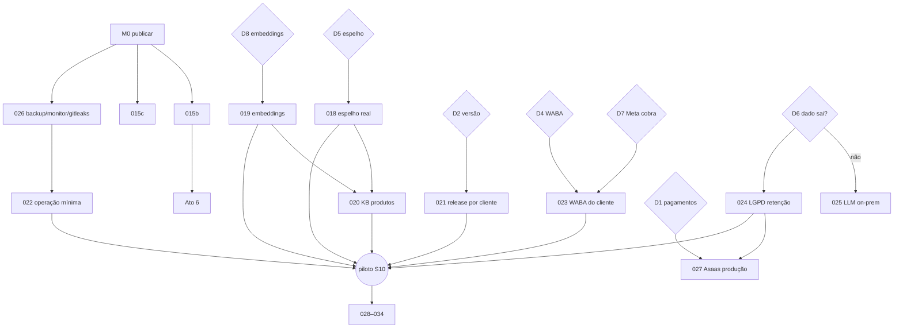

# 08 — O que falta

Cada item abaixo tem uma **pré-spec** em `specs/` com objetivo, escopo, fora de escopo,
premissas e critérios de aceite já desenhados; ela vira spec de verdade (e uma sessão de
desenvolvimento) quando entra no sprint. Datas, donos e decisões estão no
[`roadmap.md`](../roadmap.md); aqui é o mapa técnico.

## Por marco

### M0 — Publicar o que está pronto (sem spec: operação)
| Item | O que é | Depende |
|---|---|---|
| P-21 | Homelab rodando a versão atual: `deploy.sh`, rotação das senhas (resto do P-29), seed | imagens já saem com CI verde |
| P-22 | Tag `v0.1.0` como baseline ("POC completa") | P-21; esquema definitivo vem da 021 |
| P-12 (#56) | Transferir o repo para `SETA-IA/seta-atendimento` (`gitleaks git` antes; transfer, não re-push) | — |
| V-05 | Ensaio do roteiro com os sócios comerciais | P-21 |

### M1 — Agente de vendas completo
| Pré-spec | O que fecha | Reaproveita |
|---|---|---|
| [015b — aprovar/recusar no console](../../specs/015b-sdr-aprovacao-console.md) | a proposta acima da alçada é decidida por uma pessoa e o lead recebe a resposta | tela de Leads com drawer, badge da barra, `cobrancas-routes.ts` como molde |
| [015c — percentual por extenso na raia SDR](../../specs/015c-sdr-guardrail-percentual.md) | "três por cento" não passa; raia do cotista inalterada | `guardrailPreco`, teste "LACUNA" |
| P-27 | Ato 6 do roteiro de demo (SDR) | 015a |

### M2 — Blindagem (restante)
| Pré-spec | O que fecha |
|---|---|
| [026 — backup, monitor e gitleaks](../../specs/026-backup-monitor-gitleaks.md) | backup automático com restore testado; alerta no Slack se o agente ficar mudo; varredura de segredos no commit e no CI |

### M3 — Decisões (nada é código)
| Decisão | Libera |
|---|---|
| D1 pagamentos no piloto | [027 — Asaas produção](../../specs/027-asaas-producao.md) |
| D2 versionamento e instalação | [021 — release por cliente](../../specs/021-release-por-cliente.md) |
| D3 cliente-piloto (premissa: Bali Park) | 018, 020 |
| D4 WABA do piloto (iniciar já) | [023 — WABA do cliente](../../specs/023-waba-do-cliente.md) |
| D5 acesso ao espelho | [018 — espelho real](../../specs/018-espelho-real.md) |
| D6 dado sai para a Anthropic? | se não: [025 — LLM on-prem](../../specs/025-llm-on-prem.md); sempre: [024 — LGPD retenção](../../specs/024-lgpd-retencao.md) |
| D7 cobrança da Meta a partir de out/2026 | 023 (templates como utility) |
| D8 provedor de embeddings | [019 — embeddings reais](../../specs/019-embeddings-reais.md) |
| D9 quem constrói | o mapa de sprints |

### M4 — Pronto para o piloto
| Pré-spec | O que fecha | Depende |
|---|---|---|
| [018 — espelho real](../../specs/018-espelho-real.md) | plataforma lê o `bali_tse` pelas 7 views; masking completo; teste de contrato por view | D5 |
| [019 — embeddings reais](../../specs/019-embeddings-reais.md) | busca híbrida com vetor; base URL de embeddings separada | D8 |
| [020 — KB de produtos e cotas](../../specs/020-kb-produtos-e-cotas.md) | o agente explica tiers, modelos de uso e pontos com fonte | D5, 019 |
| [021 — release por cliente](../../specs/021-release-por-cliente.md) | `vX.Y.Z`, imagem por versão, config do cliente fora da imagem, `/healthz` com versão, staging | D2 |
| [022 — operação mínima](../../specs/022-operacao-minima.md) | rate limit, dead-letter inspecionável, cofre, retenção de logs, runbook | 026 |
| [023 — WABA do cliente](../../specs/023-waba-do-cliente.md) | número comercial, templates de utilidade aprovados | D4, D7 |
| [024 — LGPD retenção](../../specs/024-lgpd-retencao.md) | expurgo por política, documento com base legal, exportação e eliminação | D6 |
| [025 — LLM on-prem](../../specs/025-llm-on-prem.md) | **só se D6 negar**: vLLM dentro da rede do cliente | D6 |
| [027 — Asaas produção](../../specs/027-asaas-producao.md) | **só se D1 sim**: cobrança real | D1, 024 |

### M5 — Depois do piloto (rascunhos)
| Pré-spec | O que fecha |
|---|---|
| [028 — adaptador Seven (Winthor)](../../specs/028-adaptador-seven.md) | segunda vertical com o mesmo motor |
| [029 — copiloto de cobrança](../../specs/029-copiloto-cobranca.md) | sugestão de próxima ação para o atendente sobre a 014 e a 017 |
| [030 — campanha segmentada](../../specs/030-campanha-segmentada.md) | segmentação via catálogo, agendamento, opt-out, variável por destinatário, envio automático do relatório |
| [031 — SDR fase 2](../../specs/031-sdr-fase-2.md) | prospecção ativa, raia do cotista, parcelamento |
| [032 — configuração pela interface](../../specs/032-configuracao-pela-interface.md) | `client.yaml`, KB, catálogo, metas e usuários editáveis no console |
| [033 — mídia no WhatsApp](../../specs/033-midia-no-whatsapp.md) | fotos, áudio e documentos |
| [034 — multi-instância](../../specs/034-multi-instancia.md) | N réplicas do server; debounce fora do processo |

## Grafo de dependências

## Dívidas técnicas conhecidas

| Onde | O quê | Fecha em |
|---|---|---|
| `apps/server/src/wa/debounce.ts:77` | serialização por conversa em `Map` em memória ⇒ processo único (#33) | 034 |
| `packages/ai-provider/src/openai-compatible.ts:107` | uma base URL para chat e embed; `EMBEDDING_MODEL` vazio com a Anthropic ⇒ KB lexical | 019 |
| `packages/guardrails/src/preco.ts:23` | `RE_PERCENTUAL` exige dígito ("três por cento" passa); travado em teste | 015c |
| `packages/query-catalog/src/masking.ts` | só o masker `cnpj`; política de masking incompleta | 018 |
| `apps/server/src/boss.ts:13` | dead-letter só no log; sem inspeção nem reprocesso | 022 |
| `apps/server/src/app.ts:81` | `/healthz` sem versão | 021 |
| `apps/console/app/(console)/{disparos,ticket}` | rotas legadas que só redirecionam | remover quando nenhum link externo apontar |
| `apps/console/test` | cobertura de UI baixa (só helpers puros) | teste de componente entra com a 032 |
| `docs/roteiro-demo.md` | sem o Ato 6 (SDR) | P-27 |
| `configs/demo/contatos.yaml` | `documento` (CPF) vem de YAML — em produção precisa de base legal | 024 |

## Como este documento se mantém

Quando uma pré-spec vira spec (entra no sprint), ela ganha a data e o PR no cabeçalho, sai
desta lista e entra em [04 — Módulos entregues](04-modulos-entregues.md) ao ser mergeada.
Dívida nova entra na tabela acima com arquivo e linha.
