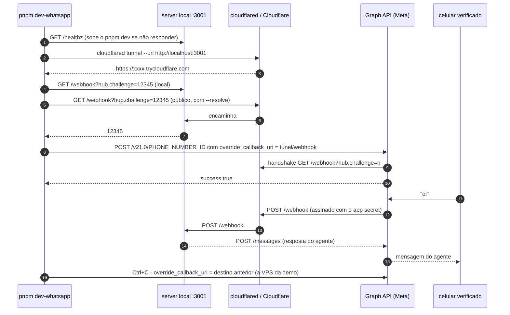

# 09 — Testar com o WhatsApp real: o túnel e o override do webhook

Este documento explica **por que** o teste com o número de WhatsApp precisa de um túnel, **por que**
o webhook é redirecionado por número (e não no app), e **o que** `pnpm dev-whatsapp` faz em cada
passo — para que dê para operar o script com confiança, fazer na mão quando ele não servir e
diagnosticar quando algo não bate. O passo a passo de criar o app Meta e o número de teste está em
[`meta-setup.md`](../meta-setup.md); aqui começa depois disso.

## O problema

A Meta entrega cada mensagem recebida com um `POST https://<sua-url-pública>/webhook`, assinado com
o app secret (`X-Hub-Signature-256`). Duas coisas atrapalham em desenvolvimento:

1. **A sua máquina não é alcançável da internet.** `localhost:3001` não existe para a Meta.
2. **O webhook do app Meta é o de produção.** O app tem uma única *Callback URL* (hoje
   `https://seta.outerlab.com.br/webhook`). Trocar essa URL para testar derruba o ambiente real
   enquanto durar o teste — e esquecer de voltar deixa produção surda.

## A solução: um túnel + override por número

O primeiro problema resolve com um **quick tunnel do Cloudflare**: `cloudflared tunnel --url
http://localhost:3001` publica uma URL `https://<aleatório>.trycloudflare.com` que encaminha para o
seu server. Não precisa de conta; a URL é aleatória e **morre com o processo**.

O segundo resolve com um recurso da Graph API pouco conhecido: além do webhook do app, **cada
phone number pode ter o seu próprio webhook** (`webhook_configuration.override_callback_uri`). Quando
existe, ele prevalece sobre o do app **só para aquele número**. O número de teste aponta para o
túnel; o webhook do app (produção) continua onde estava. Os dois convivem no mesmo app Meta.

```sh
# aplicar (com o .env carregado: set -a; . ./.env; set +a)
curl -X POST "https://graph.facebook.com/v21.0/$WA_PHONE_NUMBER_ID" \
  -H "Authorization: Bearer $WA_ACCESS_TOKEN" -H "Content-Type: application/json" \
  -d '{"webhook_configuration":{"override_callback_uri":"https://<túnel>.trycloudflare.com/webhook","verify_token":"'"$WA_VERIFY_TOKEN"'"}}'

# conferir: "application" é o webhook do app (produção), "phone_number" é o override
curl "https://graph.facebook.com/v21.0/$WA_PHONE_NUMBER_ID?fields=webhook_configuration,display_phone_number" \
  -H "Authorization: Bearer $WA_ACCESS_TOKEN"
# {"webhook_configuration":{"application":"https://n8n.setaia.com.br/webhook/…",
#                           "phone_number":"https://<túnel>.trycloudflare.com/webhook"}, …}
# (o `application` deste app é um fluxo do n8n — não é nosso; ver o aviso abaixo)

# devolver para a VPS da demo ao terminar (NÃO remova: ver o aviso abaixo)
curl -X POST "https://graph.facebook.com/v21.0/$WA_PHONE_NUMBER_ID" \
  -H "Authorization: Bearer $WA_ACCESS_TOKEN" -H "Content-Type: application/json" \
  -d '{"webhook_configuration":{"override_callback_uri":"https://api.demo.setaia.com.br/webhook","verify_token":"'"$WA_VERIFY_TOKEN"'"}}'
```

> **Remover o override não é neutro.** Sem override, o número volta ao webhook
> **do app** — e o webhook do app deste número não é nosso: é um fluxo do
> **n8n** (`n8n.setaia.com.br/webhook/…`), que divide o mesmo app Meta. Desde
> que a demo subiu na VPS (24/09/2026), o **destino de repouso** do número é
> `https://api.demo.setaia.com.br/webhook`, e é para lá que ele tem de voltar.
> O `limpar()` do script faz isso sozinho: guarda o destino antes de
> sobrescrever e devolve no `Ctrl+C`. Esvaziar o override só é certo se não
> havia nenhum. Um `curl` conferindo o `application` antes mostra para onde o
> número cairia.

Ao aplicar o override, a Meta faz na hora o **handshake** de verificação: `GET
<url>/webhook?hub.mode=subscribe&hub.verify_token=…&hub.challenge=<n>` e espera o `<n>` de volta.
O server responde isso em [`apps/server/src/wa/routes.ts`](../../apps/server/src/wa/routes.ts)
comparando com `WA_VERIFY_TOKEN`. Se o túnel ainda não estiver de pé ou o token não bater, o
`POST` do override falha.

## O que `pnpm dev-whatsapp` faz

O script é [`tools/dev-whatsapp.sh`](../../tools/dev-whatsapp.sh) (`pnpm dev-whatsapp` é só o
atalho). Ele automatiza tudo acima **e** desfaz no `Ctrl+C`, que é a parte que a gente esquece na
mão. Em ordem, com a linha do script para quem quiser conferir:



| # | Passo | Linhas | Detalhe que importa |
|---|---|---|---|
| 1 | Carrega o `.env` e exige `WA_PHONE_NUMBER_ID`, `WA_ACCESS_TOKEN`, `WA_VERIFY_TOKEN` | 19–29 | Lê também `PORT` (default 3001) e as `ASAAS_*`. A porta do console é fixa em 3000. |
| 2 | Checa `cloudflared` | 33–36 | Único pré-requisito verificado. `curl`, `lsof`, `dig` e `python3` são pressupostos. |
| 3 | `GET /healthz`. Se não responde: **preflight das portas** `PORT` e 3000 e sobe o `pnpm dev` | 80–114 | O preflight nomeia o processo dono da porta e aborta — porta 3000 presa faria o Next cair para 3001, o server morrer com `EADDRINUSE` e todo GET no túnel virar 404 do Next. O `pnpm dev` sobe num **grupo de processos próprio** (`set -m`) para o `Ctrl+C` derrubar server, console e `tsc --watch` juntos. Espera o healthz por até 3 min. Com o `pnpm dev` já rodando noutro terminal, nada disso acontece. |
| 4 | `cloudflared tunnel --url http://localhost:3001` e pega a URL do log | 116–131 | Quick tunnel: sem conta, URL aleatória, aponta para o **server** (a URL pública não serve o console nem o `/simulador`). |
| 5 | Espera `Registered tunnel connection` e prepara `curl --resolve` com o IP anycast da Cloudflare | 132–146 | A URL aparece no log **antes** de o DNS publicar o nome. Consultar cedo demais faz o resolver da máquina cachear `NXDOMAIN` por minutos e o handshake falhar em série. O `--resolve` valida sem depender do DNS local — a Meta usa o DNS dela, então não é afetada. |
| 6 | Handshake **local** (`hub.challenge=12345` em `localhost`) | 148–155 | Se não vier `12345`, o `WA_VERIFY_TOKEN` do `.env` não é o que o server carregou: reinicie o `pnpm dev`. |
| 7 | Handshake **público** pelo túnel, até 20 tentativas | 156–167 | Prova que a Meta vai conseguir verificar antes de pedir o override. |
| 8 | `POST` do override e exige `"success":true`; `GET` de conferência impresso na tela | 169–182 | O JSON impresso mostra `application` (produção) e `phone_number` (o túnel) — confira que o `display_phone_number` é o número de teste. |
| 9 | Webhook do **Asaas** pelo mesmo túnel (`seta-dev` → `/webhooks/asaas`) | 184–224 | Só com `ASAAS_API_KEY` + `ASAAS_WEBHOOK_TOKEN` + `ASAAS_WEBHOOK_EMAIL`. Best-effort: falha aqui não derruba o teste do WhatsApp. Ver [`asaas-setup.md`](../asaas-setup.md). |
| 10 | `wait` no túnel. **`Ctrl+C`** → `limpar()` | 53–78, 232 | **Devolve** o número ao destino que ele tinha antes (a VPS da demo), e só esvazia o override se não havia nenhum; desliga o webhook do Asaas, mata o túnel e o grupo do `pnpm dev` (se foi o script que subiu). Por isso o número **nunca fica apontando para uma URL morta nem cai no fluxo do n8n**. |

### Quando o `Ctrl+C` não acontece

Terminal fechado, `kill -9`, ou um túnel subido por fora do script: o `trap` não
roda, e o que sobra ligado apontando para o nada é o **webhook do Asaas** (o
override da Meta some junto com o túnel de qualquer jeito).

Isso não é barulho inofensivo. O `seta-dev` entrega **`SEQUENTIALLY`**: o
primeiro evento que falha **segura todos os seguintes**, o Asaas manda e-mail de
erro de sincronização e, se insistir, marca o webhook como `interrupted` — e aí
reativar vira passo manual no painel.

Duas defesas no script, as duas por **nome** (`seta-dev`) e não por variável
deste processo, que é justamente o que não sobrevive a um `kill -9`:

- **no boot**, avisa se achar um `seta-dev` ligado (e o registro do passo 9
  reaponta para o túnel novo);
- **no `limpar()`**, se `$ASAAS_WEBHOOK_ID` estiver vazio, procura na conta antes
  de desistir — é o caso de uma sessão anterior que morreu sem limpar.

Para desligar à mão, sem subir túnel nenhum:

```bash
set -a; . ./.env; set +a
ID=$(curl -s "$ASAAS_BASE_URL/webhooks?limit=100" -H "access_token: $ASAAS_API_KEY" \
  | python3 -c 'import sys,json; print(next((w["id"] for w in json.load(sys.stdin)["data"] if w["name"]=="seta-dev"), ""))')
curl -s -X PUT "$ASAAS_BASE_URL/webhooks/$ID" -H "access_token: $ASAAS_API_KEY" \
  -H "Content-Type: application/json" -d '{"enabled":false}'
```

A fila acumulada **não se perde e não duplica**: quando o webhook voltar a
apontar para um túnel vivo, o backlog replaya em ordem, e `evento_psp` dedupa
pelo id do evento (`onConflictDoNothing`) com `marcarProcessado` em UPDATE
condicional. É rajada de log, não problema de dado.

## Pré-requisitos

- `brew install cloudflared` (macOS). Em Linux, o pacote `cloudflared` da Cloudflare; `dig`
  (`dnsutils`/`bind-utils`), `lsof` e `python3` precisam existir — sem `dig` o script cai no DNS
  local, que funciona, só é mais sujeito ao cache de `NXDOMAIN`.
- `.env` com `WA_PHONE_NUMBER_ID`, `WA_ACCESS_TOKEN` e `WA_VERIFY_TOKEN`. **Atenção:** as duas
  primeiras vêm **comentadas** no `.env.example` (sem elas o envio é log-only, de propósito) —
  `cp .env.example .env` sozinho não basta. Os valores vêm de [`meta-setup.md`](../meta-setup.md)
  §2–3. `WA_APP_SECRET` também precisa ser o do app, senão o `POST /webhook` responde 401.
- Token: o *temporary access token* dura 24 h; para não renovar todo dia, gere um **System User
  token** (Business Settings → System Users).
- Seu celular entre os **5 destinatários verificados** do número de teste.
- Seu número mapeado em `contatos.yaml` (o arquivo apontado por `CONTATOS_PATH`) para cair no
  contrato certo do ERP mock. Fora do arquivo, o número é tratado como **lead frio** e cai na raia
  do SDR — útil para testar vendas, confuso se você esperava a raia do cotista. O `contatos.yaml`
  pode ficar fora do repo (é dado pessoal); depois de mudar, rode `pnpm demo:seed`.

## Roteiro de teste

```sh
# terminal 1 (opcional — o script sobe se não estiver de pé)
pnpm dev

# terminal 2
pnpm dev-whatsapp
#   → conferindo o server local…
#   → esperando a URL do túnel…   túnel: https://xxxx.trycloudflare.com
#   → validando o handshake…
#   → aplicando o override no número de teste…
#   ✔ pronto — webhooks do número de teste chegam no seu server local.
```

Mande "oi" do celular. Acompanhe em `http://localhost:3000/inbox` e no log do server
(`mensagem persistida → turno → outbox`). Quando terminar, `Ctrl+C` no terminal 2.

Se o túnel cair no meio (Wi-Fi, suspensão da máquina): a URL antiga morre e o override aponta
para o nada. Rode `pnpm dev-whatsapp` de novo — URL nova, override novo. Se o processo morreu sem
passar pelo `limpar()` (kill -9, máquina reiniciada), aponte o override de volta para a VPS na mão
com o `curl` da seção anterior; a Meta não avisa que o webhook está morto, o número só fica surdo.

## Na mão, sem o script

Para Linux sem os utilitários, para entender o que está acontecendo ou para depurar um passo:

```sh
set -a; . ./.env; set +a
cloudflared tunnel --url http://localhost:3001      # noutro terminal; anote a URL
URL=https://xxxx.trycloudflare.com
HS="webhook?hub.mode=subscribe&hub.verify_token=$WA_VERIFY_TOKEN&hub.challenge=12345"
curl "http://localhost:3001/$HS"                     # tem que devolver 12345
sleep 10 && curl "$URL/$HS"                          # idem, pela URL pública (espere o DNS)
curl -X POST "https://graph.facebook.com/v21.0/$WA_PHONE_NUMBER_ID" \
  -H "Authorization: Bearer $WA_ACCESS_TOKEN" -H "Content-Type: application/json" \
  -d '{"webhook_configuration":{"override_callback_uri":"'"$URL"'/webhook","verify_token":"'"$WA_VERIFY_TOKEN"'"}}'
# … teste …
# SEMPRE, ao terminar: devolva o número para a VPS. Esvaziar o override o
# entregaria ao webhook do app, que é um fluxo do n8n.
curl -X POST "https://graph.facebook.com/v21.0/$WA_PHONE_NUMBER_ID" \
  -H "Authorization: Bearer $WA_ACCESS_TOKEN" -H "Content-Type: application/json" \
  -d '{"webhook_configuration":{"override_callback_uri":"https://api.demo.setaia.com.br/webhook","verify_token":"'"$WA_VERIFY_TOKEN"'"}}'
```

## Diagnóstico

A tabela de [`meta-setup.md`](../meta-setup.md#diagnóstico-rápido) cobre o lado da Meta (token,
campo `messages`, janela de 24 h). O que é específico do túnel e do script:

| Sintoma | Causa provável | O que fazer |
|---|---|---|
| `erro: o server local não respondeu 12345 ao handshake` | `WA_VERIFY_TOKEN` do `.env` ≠ o que o server carregou (mudou o `.env` com o server de pé) | reiniciar o `pnpm dev` |
| Handshake público falha em série, `Could not resolve host` | nome consultado antes de a Cloudflare publicar o DNS; `NXDOMAIN` cacheado por até 30 min | o script já espera e usa `--resolve`; na mão, espere ~10 s ou teste com `dig @1.1.1.1` |
| Todo GET no túnel devolve **404 com HTML do Next** | porta 3000 presa por outro processo → Next caiu para 3001 → server morreu com `EADDRINUSE` | `lsof -nP -iTCP:3000 -sTCP:LISTEN`, matar o dono, subir de novo (o preflight do script pega isso quando é ele que sobe o `pnpm dev`) |
| `erro ao aplicar override: … "success":false` ou `(#100)`/`(#190)` | token expirado, sem permissão `whatsapp_business_management`, ou `WA_PHONE_NUMBER_ID` de outro app | gerar System User token com as permissões do WhatsApp; conferir o Phone number ID em API Setup |
| `erro: server não respondeu em … após 3 min` | primeiro `pnpm dev` da máquina (pull do Postgres, `tsc -b` do zero) ou erro de boot | olhar o log acima; rodar `pnpm dev` sozinho primeiro |
| Mensagem chega (log mostra `mensagem persistida`) mas nada volta | sem `LLM_*` a resposta é o fallback honesto; sem `WA_ACCESS_TOKEN` o envio é log-only | conferir o `.env`; ver o outbox no log |
| Mensagem chega mas cai na raia de **lead** (SDR) | seu número não está no `contatos.yaml` | adicionar o vínculo e `pnpm demo:seed` |
| `POST /webhook` → 401 no log | `WA_APP_SECRET` não é o do app (HMAC não bate) | App Settings → Basic → App Secret |

## Os quatro modos de falar com o agente

| Modo | Como ligar | Serve para |
|---|---|---|
| **Simulador** | `DEV_SIMULATOR=true` (default do `.env.example`) e `http://localhost:3000/simulador` | quase tudo: injeta pelo mesmo caminho do webhook (idempotência, debounce, turno, outbox) e mostra a resposta por SSE. Plano B da demo. |
| **Log-only** | sem `WA_ACCESS_TOKEN` | receber webhooks reais sem enviar nada (o envio vira linha de log) |
| **Real em dev** | `pnpm dev-whatsapp` (túnel + override no número de teste) | ida e volta de verdade: assinatura HMAC, status de entrega, templates, janela de 24 h, webhook do Asaas |
| **Produção** | Caddy em `seta.outerlab.com.br` → `:3001`; webhook do **app** Meta | o ambiente real ([`deploy-homelab.md`](../deploy-homelab.md)) — nunca é tocado pelo modo acima |

O contrato do webhook (GET de verificação, POST assinado, status de entrega, 200 sempre para a
Meta não re-tentar) está em [`05-dados-e-integracoes.md`](05-dados-e-integracoes.md) e no código em
[`apps/server/src/wa/routes.ts`](../../apps/server/src/wa/routes.ts).

## O indicador de digitação ("digitando…")

Antes, o contato mandava mensagem e ficava **sem sinal nenhum** até a resposta chegar: o
debounce espera de 6 a 15 s de silêncio (`WA_DEBOUNCE_MS`, com a janela adaptativa de 0,6× a
1,5×) e só depois o turno roda o classificador, o grafo e as tools. Para quem está do outro
lado, a conversa parecia morta. Agora o agente aparece **lida + digitando…** enquanto pensa.

### O contrato da Meta, e o que ele arrasta consigo

É um POST no **mesmo** `/<PHONE_NUMBER_ID>/messages` do envio, mas com `status: 'read'`:

```json
{ "messaging_product": "whatsapp", "status": "read", "message_id": "<WAMID_RECEBIDO>",
  "typing_indicator": { "type": "text" } }
```

Quatro consequências que **não são escolha nossa**:

- **marca a mensagem como LIDA** — dois tiques azuis, do robô, antes de ele responder. É um
  request só: não existe indicador sem leitura. É o efeito mais visível da feature, e é o
  motivo de `WA_TYPING_INDICATOR` existir (ver abaixo);
- **exige o wamid de uma mensagem RECEBIDA** — por isso disparo proativo (campanha da 013,
  aviso de pagamento) não tem indicador: não há mensagem de entrada para reagir. Limite da
  plataforma, não decisão nossa;
- **dura no máximo 25 s**, ou até a resposta sair, o que vier primeiro;
- a resposta é `{ "success": true }`, **sem** `messages[0].id`.

Esse último ponto é a armadilha do código: o `postMessages` do gateway exige
`messages[0].id` e lançaria `'Graph API sem message id na resposta'` em **todo** indicador
bem-sucedido. Por isso a parte compartilhada (URL, headers, erro de HTTP) foi extraída para
[`packages/wa-meta/src/graph.ts`](../../packages/wa-meta/src/graph.ts) e a leitura do corpo
ficou com cada chamador. Há teste travando isso (`indicador-digitacao.test.ts`).

### Onde mora, e por que não é um método do gateway

O port é `IndicadorDigitacao` em
[`packages/wa-meta/src/indicador-digitacao.ts`](../../packages/wa-meta/src/indicador-digitacao.ts),
com `createMetaIndicador` (real) e `createLogIndicador` (dev), **não** um 4º método de
`OutboundGateway`. O motivo é estrutural: o único código que chama o gateway é o worker do
outbox, e é justamente por o turno-handler **não ter o gateway na mão** que a invariante "toda
resposta passa pelo outbox" (dedupe `turnoId:seq`, retry do pg-boss, janela de 24 h,
reengajamento por template) se sustenta sozinha. Dar o gateway ao handler para mostrar
"digitando" tornaria furar essa invariante um autocomplete de distância. Mesma doutrina do
`ResolvedorAnexo` no outbox.

O disparo é no **topo de `processar`** do turno-handler, e o lugar é a parte que importa:

- **depois do debounce**: disparar no webhook gastaria mais da metade dos 25 s esperando
  silêncio;
- **depois do `ticketGate`**: ticket `humano_ativo` não cria turno, então bot silenciado nunca
  aparece digitando;
- **antes do trabalho do modelo**, que é exatamente o tempo que a feature cobre.

O wamid da última mensagem agregada viaja do debouncer até o handler em
`TurnoPronto.waMessageIdUltima` — da **última**, porque numa rajada é o id dela que a Meta
aceita.

### Renovação, e por que ela existe

O teto da Meta é 25 s, mas `AGENT_TURN_TIMEOUT_MS` é 60 s. Um turno com tools pode passar dos
25 s e o contato veria o "digitando" apagar antes da resposta. Então o disparo se **renova a
cada 20 s**, com teto de 3 renovações (~80 s, além do timeout do turno — o teto existe para o
timer nunca ser eterno).

O `parar()` acontece em **dois** lugares, e os dois são necessários:

- no **enfileiramento da resposta** (`enviar`/`enviarVarias`): é o momento em que responder
  deixa de ser hipótese. Sem isso, entre o enqueue e o fim do turno ainda rodam
  `escalarTicket`, `gravarSinaisDeVerdict`, `emitirObservabilidade` e `gravarTrace` — e uma
  renovação caindo nessa janela acenderia "digitando" com a resposta já a caminho, por 25 s;
- no **`finally`** de `processar`: rede de segurança, inclusive no caminho de exceção.

Os timers são `setTimeout` em cadeia (um handle por vez, sem sobreposição) e `unref()`ados: o
indicador nunca segura o encerramento do processo nem o teardown da suíte de testes. O
`parar()` também **aborta o request em vôo** (`AbortController` repassado ao `fetch`): matar o
timer não impede um request que já saiu de pousar na Meta depois do envio.

### O turno instantâneo, e o read receipt que ele abre mão

Nem todo turno chama o modelo. O opt-out (044), o `TEXTO_JA_NA_FILA` (#47) e **todo** turno em
dev sem `LLM_*` respondem em dezenas de milissegundos — menos do que o request do indicador
leva para chegar à Meta. Sem cuidado, a ordem seria: acende o indicador → a resposta sai → o
request pousa depois → e aí **não há mais nada que o apague**, porque o que apaga o indicador é
o envio da mensagem. O contato pediria para sair da lista, receberia a confirmação, e veria o
robô "digitando" por 25 s. É o pior lugar possível para esse defeito.

Por isso o **primeiro** disparo é atrasado em 250 ms (`ATRASO_INICIAL_DIGITACAO_MS`, injetável
por `digitacaoAtrasoMs` nos testes). Turno que termina antes disso não acende nada, de forma
determinística, em vez de depender de quem ganha a corrida. Em turno de LLM os 250 ms são
imperceptíveis: o contato já esperou o debounce inteiro.

**Consequência deliberada, e não defeito:** como o indicador e o read receipt são o MESMO
request, não acender nada significa também **não marcar a mensagem como lida**. Quem escreve
"sair" recebe a confirmação sem os dois tiques azuis. É a troca certa — a própria resposta é o
reconhecimento, e ela chega em menos de um segundo, o que é melhor do que um "digitando"
fantasma por 25 s depois dela. Se algum dia o receipt nesses caminhos for requisito, o desenho
muda: seria um `status:'read'` puro disparado sempre, com o indicador por cima só quando vale.

### Enfeite, não obrigação

Falha de rede, 400 da Meta, indicador pendurado ou nem configurado ⇒ **a resposta sai igual**,
o turno não cai no fallback de emergência, o trace é gravado normalmente e nada é re-tentado.
Sai um `warn` com `turnoId` e `traceId`. O disparo nunca é `await`ado — não entra no caminho
crítico. Três testes de integração travam isso em `agente.integration.test.ts`.

### Nos quatro modos

| Modo | O que acontece |
|---|---|
| **Simulador** | a bolha de três pontos aparece na tela do `/simulador`. Ela **não** vem da chamada à Graph API (em dev ela não acontece): o SSE de `/dev/events` reproduz o mesmo estado que acende o indicador no WhatsApp — turno aberto, resposta ainda não enviada (`estadoDigitando` em `dev-routes.ts`) |
| **Log-only** | `createLogIndicador`: uma linha `indicador de digitação simulado (log-only)` por turno, mesmo caminho de código do real |
| **Real em dev** (`pnpm dev-whatsapp`) | o indicador de verdade no celular. Os ids sintéticos do simulador (`sim-…`) são filtrados por `ehWamidDaMeta` — sem isso, cada turno simulado viraria um 400 e um `warn` sobre um caminho que está correto |
| **Produção** | idem real; `WA_TYPING_INDICATOR=false` desliga sem deploy |

### Desligar

`WA_TYPING_INDICATOR=false` (default `true`). O botão existe para **um** caso: como a Cloud
API não separa o indicador da marcação de leitura, um cliente que não queira os dois tiques
azuis do robô precisa poder desligar as duas coisas com um restart, não com um revert.
